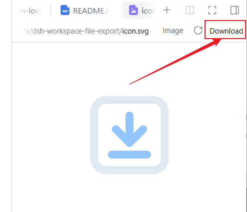

# dsh-workspace-file-export



DeepSeek-Harness 插件，提供工作区文件导出（下载到本地）功能。

在文档预览头部添加「Download」链接，提供仅限已注册工作区内的认证文件下载。

## 为何不使用名称 dsh-workspace-download

因 npm 禁止上传含 download 的包名，因此使用 dsh-workspace-file-export 。

## 功能

- 侧边栏打开工作区文件预览时，标题栏 actions 区出现 **Download** 链接
- 下载走 `GET /api/workspace-download`，只允许任一已注册 workspace 的 canonical 根内的普通文件（含符号链接逃逸校验）
- 路由注册在 connection 的认证栅栏内：未登录的请求到不了这里
- 允许范围以 **已注册工作区** 为准；workspace 注册表是项目列表而非权限边界，HTTP 连接也没有会话身份，因此它防的是任意路径读取，不做「请求属于哪个工作区」的会话绑定

## 安装

```sh
git clone https://github.com/honghe/dsh-workspace-file-export.git
cd dsh-workspace-file-export
dsh plugin --profile web add ./
```

也可以直接从 GitHub 安装（仓库里已提交构建好的 `client.js`，安装时无需构建）：

```sh
dsh plugin --profile web add github:honghe/dsh-workspace-file-export
```

也可以从 npm 安装（包名是 `dsh-workspace-file-export`，GitHub 仓库名仍为 `dsh-workspace-file-export`）：

```sh
dsh plugin --profile web add dsh-workspace-file-export
```

也可以在 GUI 里安装：侧边栏 → **插件** → **添加插件** → **安装第三方插件** → 填本目录绝对路径 → 安装并启用。

首次安装 bundle 后需重启一次 `dsh web` 生效（之后对配置/开关的修改走热加载）。

## 使用

1. 在侧边栏打开工作区内任意文件（右侧文档预览）
2. 点击预览头部的 **Download**

## HTTP 接口

```
GET|HEAD /api/workspace-download?path=<绝对路径>
```

| 状态码 | 含义 |
|---|---|
| 200 | 流式下载（`Content-Disposition: attachment`） |
| 400 | 缺少/非法参数（`path` 必须是绝对路径） |
| 403 | 解析结果不在任何已注册 workspace 的 canonical 根内 |
| 404 | 文件不存在或不是普通文件 |

## 目录结构

- `index.js` — Host 半区：注册下载路由
- `src/client/index.tsx` → `client.js` — Client 半区：注册 Download 链接
- `cordis.patch.yml` — bundle 层，插入上面的 Host 行
- `locale/` — 插件页展示的标题与描述
- `tsdown.config.ts` — 重建 `client.js` 的构建配置（tsdown / Rolldown）

## 开发

- Host 半区是纯 ESM、无依赖，不需要构建
- 首次构建先在本目录 `pnpm install`（安装 devDependency tsdown）
- 改 `src/client/index.tsx` 后运行 `pnpm run build` 重建 `client.js`；`tsdown.config.ts` 用 banner/intro/footer 把产物包成 `window.__ModuleLoader__.load(...)`，与 dsh 自己的 client 产物形状一致
- `pnpm pack` / `pnpm publish` 前会自动执行 `prepack`（即 `tsdown`），打包进的是最新 `client.js`；因此打包机需要先 `pnpm install`
- CI（[.github/workflows/ci.yml](.github/workflows/ci.yml)）会执行 `pnpm install --frozen-lockfile && pnpm run build`，并校验 `client.js` 与源码一致：改了 `src/` 忘记重建的提交会直接失败
- 本插件以 `link:` 方式安装，代码修改后需重启 `dsh web`；普通安装不会触发任何构建脚本

## License

MIT — 见 [LICENSE](LICENSE)。
